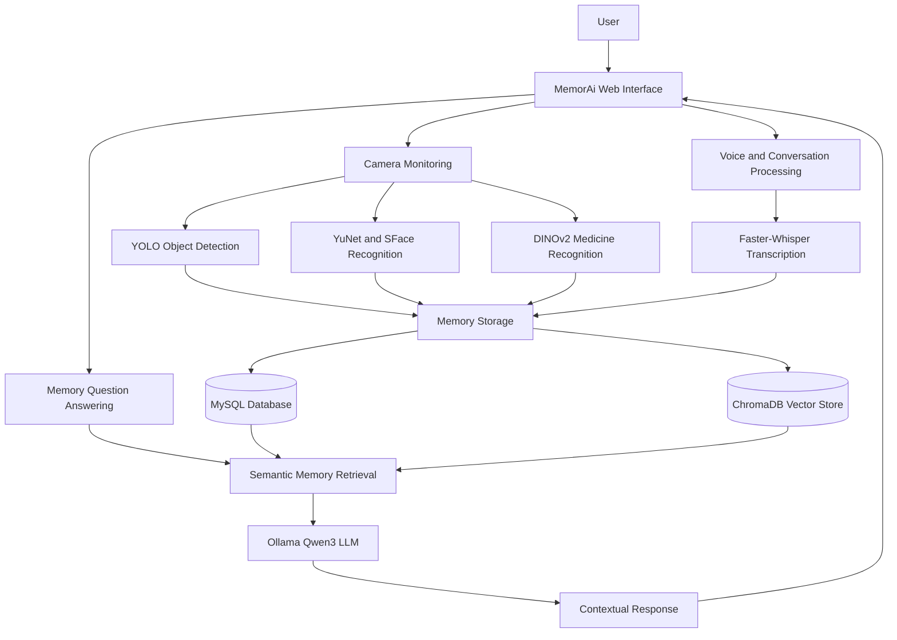

# 🧠 MemorAi — AI-Powered Digital Memory Assistant

### An Intelligent Memory Assistance System for Elderly Individuals


---

## 📌 Project Overview

**MemorAi** is an AI-powered digital memory assistance system designed to support elderly individuals experiencing age-related memory difficulties.

The system combines **Artificial Intelligence, Machine Learning, Deep Learning, Computer Vision, Natural Language Processing (NLP), and Retrieval-Augmented Generation (RAG)** to create an intelligent personal memory assistant.

MemorAi observes and records important information about everyday objects, familiar people, conversations, and medication-related activities.

Users can retrieve previously recorded information through natural-language questions, making it easier to recall past events and access useful memories.

The project focuses on providing a user-friendly, accessible, and intelligent solution for everyday memory assistance.

---

## 🎯 Problem Statement

Elderly individuals may experience difficulties remembering:

- Where they last placed everyday objects.
- Names and identities of familiar people.
- Important information discussed in conversations.
- Medication schedules and medication-related activities.
- Previous events and daily interactions.

Traditional reminder applications depend heavily on manual data entry and cannot automatically recognize objects, people, or activities.

**MemorAi addresses these limitations by integrating computer vision, speech processing, semantic memory retrieval, and AI-based question answering into a unified system.**

---

## 🚀 Project Objectives

1. Develop an intelligent digital memory assistant for elderly individuals.
2. Detect and record important everyday objects using computer vision.
3. Recognize registered individuals through facial recognition.
4. Capture and retrieve important conversation information.
5. Monitor registered medicines and medication-related activities.
6. Store memory records in structured and vector databases.
7. Enable natural-language memory retrieval using RAG.
8. Provide text-based and voice-based interaction.
9. Display historical activities through a unified memory timeline.
10. Create an accessible and user-friendly web interface.

---

## ✨ Key Features

### 🔍 1. Intelligent Object Detection and Memory

MemorAi uses **YOLO11s** for detecting important everyday objects through a webcam.

**Features:**
- Real-time object detection.
- Object identification and classification.
- Multi-frame detection confirmation.
- Timestamp-based event recording.
- Object-location memory.
- Duplicate event reduction using cooldown mechanisms.
- Storage of detected events for future retrieval.

**Example:**

User: "Where did I last keep my phone?"

MemorAi: "Your phone was last observed on the table at 10:30 AM."

The response is based on previously stored observations rather than an assumption about the object's current location.

### 👤 2. Facial Recognition and Person Memory

MemorAi integrates **YuNet and SFace** for detecting and recognizing registered individuals.

**Features:**
- Face detection using YuNet.
- Face recognition using SFace embeddings.
- Registration of familiar individuals.
- Storage of names and relationships.
- Multi-sample face registration.
- Face similarity matching.
- Recognition event logging.
- Retrieval of person-related memories.

**Example:**

User: "Who is Rahul?"

MemorAi: "Rahul is your grandson."

This information is retrieved from registered person records.

### 🎙️ 3. Conversation Memory

The conversation memory module uses **Faster-Whisper** for speech transcription and NLP-based processing.

**Features:**
- Speech-to-text conversion.
- Conversation transcription.
- Identification of important conversation information.
- Conversation metadata extraction.
- Storage of relevant conversation records.
- Semantic search across remembered conversations.
- Retrieval of previously discussed information.

**Example:**

User: "What did my daughter tell me yesterday?"

MemorAi retrieves relevant information from previously saved conversation records.

Conversation recording and storage are controlled by the application's settings and importance-processing mechanisms.

### 💊 4. Medicine Recognition and Monitoring

MemorAi includes a computer-vision-based medicine monitoring system.

**Technologies:**
- DINOv2
- EasyOCR
- OpenCV
- MediaPipe

**Features:**
- Medicine registration.
- Visual medicine recognition.
- OCR-based medicine identification support.
- Medication schedule management.
- Hand and medicine interaction monitoring.
- Camera-assisted medication event detection.
- Medication event history.
- Retrieval of medication-related information.

**Medication monitoring states include:**
- Camera Confirmed
- Unconfirmed
- Low Confidence
- Missed

**Example:**

User: "Did I take my medicine this morning?"

MemorAi reports the available medication observation status.

**Important:** Camera-confirmed events represent visual evidence of a medication-related action. They do not medically verify that a medicine was swallowed.

### 🧠 5. Retrieval-Augmented Generation (RAG)

MemorAi uses a RAG-based architecture to retrieve information from stored memory records and generate contextual responses.

**Technologies:**
- BGE Small English Embeddings
- ChromaDB
- Ollama
- Qwen3:4b

**Working:**

1. User submits a natural-language question.
2. The system identifies relevant memory information.
3. Stored memories are searched using semantic retrieval.
4. Relevant memory records are provided to the language model.
5. The language model generates a contextual response.
6. The response is displayed to the user.

The system is designed to avoid inventing memories when reliable supporting records are unavailable.

### 🎤 6. Voice-Based Memory Assistant

MemorAi supports voice-based interaction using speech recognition and text-to-speech functionality.

**Features:**
- Voice question input.
- Speech transcription.
- Natural-language question processing.
- Memory-based answer generation.
- Optional spoken responses.

### 📅 7. Unified Memory Timeline

The memory timeline combines information from multiple modules.

**Includes:**
- Object detection events.
- Person recognition events.
- Important conversation records.
- Medication-related events.

The timeline allows users to review recorded activities and access previous memories.

### 🖥️ 8. Interactive Web Dashboard

MemorAi provides an interactive interface developed using **NiceGUI**.

**Main sections:**
- Home Dashboard
- Ask MemorAi
- Voice Assistant
- Camera Monitoring
- People
- Conversations
- Medicines
- Memory Timeline
- Settings

The repository also includes a Streamlit-based interface.

---

## 🛠️ Technology Stack

| Category | Technologies |
|---|---|
| Programming Language | Python |
| Computer Vision | OpenCV, YOLO11s |
| Face Detection | YuNet |
| Face Recognition | SFace |
| Medicine Recognition | DINOv2, EasyOCR |
| Hand Tracking | MediaPipe |
| Speech Recognition | Faster-Whisper |
| Natural Language Processing | Transformers, Sentence Transformers |
| Large Language Model | Qwen3:4b |
| LLM Runtime | Ollama |
| Vector Database | ChromaDB |
| Relational Database | MySQL |
| Embedding Model | BAAI/bge-small-en-v1.5 |
| User Interface | NiceGUI, Streamlit |
| Deep Learning Framework | PyTorch |
| Supporting Libraries | NumPy, Pandas, Pillow, scikit-learn |

---

## 🏗️ System Architecture



---

## ⚙️ How MemorAi Works

### Step 1: Data Acquisition

The system captures information through a webcam, microphone, and registered user information.

### Step 2: AI-Based Processing

Different AI models process the captured data:

- YOLO11s detects objects.
- YuNet and SFace recognize people.
- DINOv2 and OCR support medicine recognition.
- MediaPipe analyzes hand-related activity.
- Faster-Whisper transcribes speech.

### Step 3: Memory Creation

Relevant observations are converted into structured memory records containing information such as event type, timestamp, identity, and available contextual details.

### Step 4: Memory Storage

MySQL stores structured application records, while ChromaDB supports semantic retrieval using vector embeddings.

### Step 5: Memory Retrieval

When a user asks a question, MemorAi searches relevant stored memories using retrieval techniques.

### Step 6: Response Generation

The retrieved context is processed using the locally configured Ollama language model to generate a clear, memory-grounded response.

---

## 📂 Project Structure

```text
MemorAi/
│
├── app/
│   ├── nicegui_app.py
│   ├── nicegui_ui/
│   ├── services/
│   ├── streamlit_app.py
│   └── ui/
│
├── conversation/
│   ├── conversation_service.py
│   ├── conversation_repository.py
│   ├── importance_analyzer.py
│   └── metadata_extractor.py
│
├── database/
│   ├── db_manager.py
│   ├── mysql_connection.py
│   ├── event_repository.py
│   ├── person_repository.py
│   └── medicine_repository.py
│
├── face/
│   ├── face_recognition.py
│   ├── person_registration.py
│   └── person_monitor.py
│
├── llm/
│   └── chat.py
│
├── medicine/
│   ├── medicine_recognizer.py
│   ├── medicine_registration.py
│   ├── medicine_monitor.py
│   └── medicine_action_tracker.py
│
├── memory/
│   ├── retriever.py
│   ├── person_retriever.py
│   ├── conversation_retriever.py
│   └── medicine_retriever.py
│
├── rag/
│   ├── embeddings.py
│   ├── memory_search.py
│   ├── person_memory_search.py
│   └── medicine_memory_search.py
│
├── speech/
│   ├── transcription.py
│   ├── whisper_module.py
│   └── voice_chat.py
│
├── timeline/
│   └── timeline_manager.py
│
├── vision/
│   ├── object_detector.py
│   ├── detection_confirmor.py
│   └── event_logger.py
│
├── models/
├── data/
├── tests/
├── utils/
│
├── config.py
├── .env.example
├── requirements.txt
└── README.md
```

---

## 💻 Installation and Setup

### Prerequisites

Ensure that the following are available:

- Python and pip
- Git
- MySQL Server
- Ollama
- Webcam
- Microphone for voice functionality
- Required AI model files

A CUDA-compatible GPU may improve inference performance, although several components support CPU execution.

### Step 1: Clone the Repository

```bash
git clone https://github.com/SakshiCC/MemorAi.git
cd MemorAi
```

### Step 2: Create a Virtual Environment

```bash
python -m venv .venv
```

Activate the environment.

**Windows:**

```bash
.venv\Scripts\activate
```

**Linux/macOS:**

```bash
source .venv/bin/activate
```

### Step 3: Install Dependencies

```bash
pip install -r requirements.txt
```

The project contains several AI and computer vision dependencies. Installation may require a compatible Python environment and platform-specific adjustments.

### Step 4: Configure Environment Variables

Copy the provided environment template.

**Windows:**

```bash
copy .env.example .env
```

**Linux/macOS:**

```bash
cp .env.example .env
```

Edit `.env` and configure your local MySQL credentials, model paths, and application settings.

Example:

```env
DB_HOST=localhost
DB_PORT=3306
DB_USER=root
DB_PASSWORD=your_mysql_password
DB_NAME=Memor_ai

CAMERA_INDEX=0
YOLO_MODEL_PATH=models/yolo/yolo11s.pt

CHROMA_PATH=chroma_data
CHROMA_COLLECTION_NAME=memorai_memories
EMBEDDING_MODEL_NAME=BAAI/bge-small-en-v1.5

OLLAMA_BASE_URL=http://localhost:11434
OLLAMA_MODEL=qwen3:4b

WHISPER_MODEL_SIZE=small
WHISPER_DEVICE=cpu
WHISPER_COMPUTE_TYPE=int8

MEMORAI_STORAGE_SECRET=replace_with_a_long_random_secret
```

Never commit your real `.env` file or database credentials to GitHub.

### Step 5: Configure MySQL

Create the database if it does not already exist.

```sql
CREATE DATABASE IF NOT EXISTS Memor_ai;
```

The NiceGUI application initializes its database tables during startup.

### Step 6: Configure Ollama

Install Ollama from:

https://ollama.com/

Download the configured language model:

```bash
ollama pull qwen3:4b
```

Ensure the Ollama service is running.

### Step 7: Verify AI Models

Ensure that the required model files are available in their configured directories.

Examples include:

- YOLO11s object detection weights.
- YuNet face detection model.
- SFace face recognition model.
- MediaPipe hand landmarker model.

Some pretrained models may be downloaded automatically when first used.

### Step 8: Run MemorAi

Start the NiceGUI application from the project root:

```bash
python -m app.nicegui_app
```

Open:

```text
http://127.0.0.1:8080
```

**Alternative Streamlit interface:**

```bash
streamlit run app/streamlit_app.py
```

The NiceGUI application provides the more comprehensive interface in this repository.

---

## 🧪 Testing

The repository includes module-specific tests for:

- Object detection and memory retrieval.
- Face registration and recognition.
- Person memory retrieval.
- Conversation processing.
- Speech transcription.
- Medicine recognition and monitoring.
- Vector memory integration.
- Unified RAG.
- Unified memory timeline.

Individual tests can be executed using Python, for example:

```bash
python -m tests.test_unified_rag
```

Some tests require configured databases, downloaded models, camera access, or other local dependencies.

---

## 📊 Project Highlights

| Module | Implementation |
|---|---|
| Object Detection | YOLO11s with temporal confirmation |
| Facial Recognition | YuNet and SFace |
| Conversation Memory | Faster-Whisper with importance analysis |
| Medicine Recognition | DINOv2 and OCR |
| Medication Action Analysis | MediaPipe-based visual tracking |
| Memory Retrieval | BGE embeddings and ChromaDB |
| Question Answering | RAG with Qwen3 through Ollama |
| Database | MySQL |
| User Interface | NiceGUI |
| Event History | Unified Memory Timeline |

---

## 🔐 Privacy and Responsible AI

MemorAi processes sensitive information, including facial images, conversations, and medication-related observations.

The system emphasizes responsible handling of personal memory information.

Important considerations include:

- Obtain consent before registering or recording individuals.
- Protect database credentials and locally stored data.
- Avoid publicly exposing personal recordings and facial images.
- Review application settings before enabling conversation recording.
- Use stored evidence to support generated responses.
- Avoid making unsupported claims about past events.
- Treat medication observations as assistance rather than medical verification.

MemorAi is a prototype and should not replace professional medical care, medication administration supervision, or emergency assistance.

---

## ⚠️ Current Limitations

- Recognition accuracy depends on lighting, camera quality, and viewing angle.
- Object detection is limited by the available trained model classes.
- The last observed object location may differ from its current location.
- Face recognition performance can vary with occlusion and appearance changes.
- Speech transcription may be affected by background noise and pronunciation.
- Medicine recognition depends on reference images and visual similarity.
- Camera-based medication monitoring cannot guarantee actual medicine ingestion.
- AI responses depend on the quality and availability of stored memory records.
- The system requires local configuration of multiple AI models and services.

---

## 🔮 Future Enhancements

Potential improvements include:

1. Custom-trained object detection for additional household items.
2. Improved object tracking and location estimation.
3. Enhanced face recognition under difficult lighting conditions.
4. Multilingual voice interaction.
5. Improved medicine recognition and activity analysis.
6. Personalized reminders and notification mechanisms.
7. Caregiver-oriented monitoring features with appropriate permissions.
8. Improved accessibility and simplified interaction.
9. Mobile-friendly deployment.
10. Performance optimization for resource-constrained devices.

---

## 🌍 Applications

MemorAi can be explored for:

- Elderly memory assistance.
- Personal memory organization.
- Assisted-living technology research.
- AI-based activity logging.
- Smart home assistance.
- Human-computer interaction.
- Multimodal AI research.
- Retrieval-Augmented Generation applications.

---

## 👩‍💻 Developer

**Sakshi Chabukswar**

M.Sc. (Computer Applications) — Data Science

**Areas of Interest:**
- Software Development
- Artificial Intelligence
- Machine Learning
- Deep Learning
- Computer Vision
- Natural Language Processing
- Data Science

**GitHub:** [SakshiCC](https://github.com/SakshiCC)

**Project Repository:** [MemorAi](https://github.com/SakshiCC/MemorAi)

---

## ⭐ Project Vision

The vision behind MemorAi is to explore how Artificial Intelligence can support everyday memory assistance through intelligent observation, information retrieval, and natural-language interaction.

By integrating computer vision, speech recognition, structured databases, vector search, and local language models, MemorAi demonstrates a multimodal approach to building context-aware personal AI assistants.

---

**🧠 MemorAi — Remembering Moments, Supporting Memories.**
